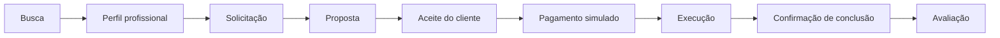

# Conecta Santa Maria

**Uma plataforma para aproximar quem precisa de um serviço de quem sabe realizá-lo.**

Marketplace de serviços locais pensado para Santa Maria–RS. Reúne profissionais de construção, manutenção, tecnologia, contabilidade e outros setores em uma experiência que vai da descoberta do prestador ao acompanhamento da contratação.

> **Status: MVP de validação.** Os pagamentos são simulados, sem movimentação financeira. O projeto ainda não está pronto para operação comercial aberta.

[Funcionalidades](#funcionalidades) · [Arquitetura](#arquitetura-e-decisões-técnicas) · [Executar localmente](docs/DEVELOPMENT.md) · [Segurança do repositório](docs/SECURITY.md)

## O problema

Encontrar um profissional costuma exigir buscas em diferentes canais, troca de contatos e negociação sem um histórico centralizado. Para quem presta serviços, apresentar o próprio trabalho e organizar solicitações também pode ser difícil.

O Conecta Santa Maria propõe reunir descoberta, orçamento e acompanhamento em um único lugar, começando por uma cidade para validar oferta, demanda e experiência de uso.

## Funcionalidades

| Área | Implementação atual |
| --- | --- |
| Descoberta | Busca por termos relacionados e filtros por categoria, bairro, preço, avaliação, disponibilidade e modalidade de atendimento. |
| Perfil profissional | Apresentação, especialidades, região atendida, preços de referência e fotos públicas de perfil e portfólio. |
| Contratação | Solicitação, proposta com escopo e prazo, aceite de orçamento e acompanhamento das etapas. |
| Comunicação | Mensagens persistentes por pedido, com atualização manual. |
| Monetização | Comissão configurável, com valores bruto, comissão e líquido registrados na proposta. |
| Pagamentos | Simulação interna de pagamento e reembolso, identificada na interface. |
| Reputação | Avaliação permitida ao cliente após a conclusão do serviço, uma vez por contratação. |
| Administração | Moderação de perfis, configuração de comissão, consulta de pedidos, denúncias e indicadores simulados. |
| Acesso mobile | Layout responsivo e recursos de PWA, conforme suporte do navegador. |

Clientes e prestadores podem ser a mesma pessoa. As permissões de cada pedido dependem de quem contrata e de quem executa o serviço.

## Fluxo de contratação



Cancelamento e disputa complementam esse fluxo conforme a etapa da contratação.

## Arquitetura e decisões técnicas

| Camada | Tecnologias |
| --- | --- |
| Interface | React 19, TypeScript, Tailwind CSS e componentes acessíveis baseados em Radix UI. |
| Aplicação | Vinext sobre Vite, com convenções de roteamento compatíveis com Next.js. |
| Execução no servidor | Cloudflare Workers. |
| Persistência | D1 / SQLite, com esquema e migrações gerados pelo Drizzle. |
| Arquivos | R2 para fotos públicas de perfil e portfólio. |
| Identidade | Integração de autenticação ChatGPT/Sites; identidade simulada no desenvolvimento local. |
| Testes | Test runner nativo do Node.js e testes HTTP de integração. |

O projeto explora o desenvolvimento de um marketplace completo, incluindo regras de negócio e persistência:

- **Valores em centavos:** cálculo de comissão com arredondamento explícito e conferência entre bruto, comissão e líquido.
- **Autorização no servidor:** cada operação verifica a identidade e a participação do usuário no pedido.
- **Controle de concorrência:** a versão do pedido é verificada antes de atualizar seu estado.
- **Aceite por revisão:** o cliente precisa aceitar a revisão atual do orçamento.
- **Histórico de condições:** mudanças na comissão configurada não alteram propostas já registradas.
- **Privacidade do contato:** o telefone só é retornado no perfil público quando o prestador autoriza.
- **Separação entre dados e código:** banco local, arquivos enviados e configurações privadas ficam fora do versionamento.

### Estrutura

```text
app/           Páginas, interface e rotas de API
components/    Componentes compartilhados
lib/           Regras de negócio e acesso ao banco
db/            Esquema de dados
drizzle/       Migrações e metadados do esquema
public/        Ícones, manifesto PWA e service worker
scripts/       Preparação local e verificações
tests/         Testes de domínio e integração
docs/          Documentação técnica e de segurança
```

## Qualidade e validação

Os testes de domínio cobrem cálculo de comissão e transições do pedido. Os testes HTTP exercitam autenticação, acesso de terceiros, privacidade do telefone, orçamento, aceite, pagamento simulado, chat, conclusão, avaliação e reembolso.

```bash
npm run typecheck
npm test
npm run check:public
```

Os testes de integração exigem um servidor e banco locais preparados. Veja as instruções em [Desenvolvimento](docs/DEVELOPMENT.md).

## Executar localmente

Requisitos: **Node.js 22.13 ou superior, npm e Git**.

```bash
npm run install:ci
npm run setup:local
npm run build
```

Aplique a migração inicial no banco local e execute `npm run dev`, seguindo o [guia de instalação](docs/DEVELOPMENT.md). O comando `setup:local` cria configurações a partir dos exemplos e preserva arquivos existentes.

## Escopo atual e próximos passos

O MVP permite avaliar o fluxo de contratação. Para uso comercial, ainda são necessários:

- Integração com provedor de pagamento: recebimentos, divisão de valores, webhooks, taxas e reembolsos reais.
- Autenticação pública independente por e-mail ou telefone.
- Notificações e melhorias na atualização das conversas.
- Gestão administrativa de categorias e subcategorias; atualmente há categorias fixas e especialidades em texto.
- Verificação documental e anexos privados em pedidos.
- Processos operacionais para disputas, exclusão de contas, suporte e moderação.
- Revisão dos termos de uso, política de privacidade e regras comerciais.
- Controles de abuso, monitoramento, backups e testes de capacidade antes de campanhas de aquisição.

Planos pagos, destaques patrocinados e expansão para outras cidades são possibilidades futuras, ainda não implementadas.

## Segurança e publicação

O repositório deve conter apenas código, recursos públicos, migrações de esquema e exemplos de configuração sem credenciais. A configuração de hospedagem vinculada à conta permanece local.

A autenticação atual depende da camada confiável do Sites. Publicar o código no GitHub **não torna o aplicativo acessível na web** e não substitui a configuração segura de hospedagem.

Leia [Segurança do repositório](docs/SECURITY.md) antes do primeiro envio. A verificação automatizada é auxiliar e não garante a ausência de todo tipo de dado sensível.
